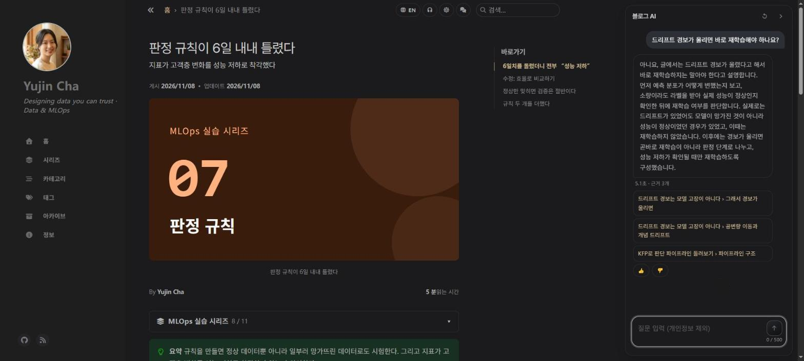
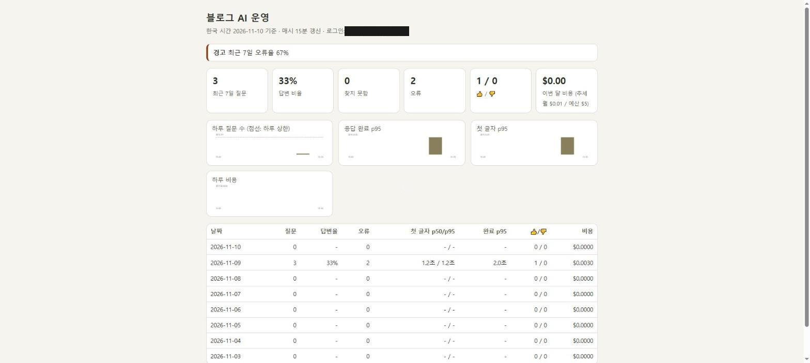
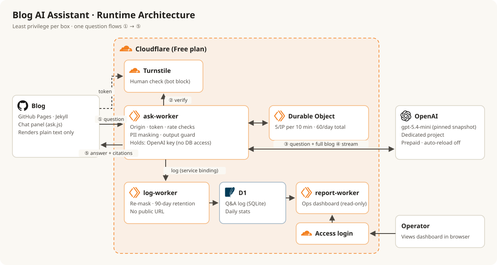
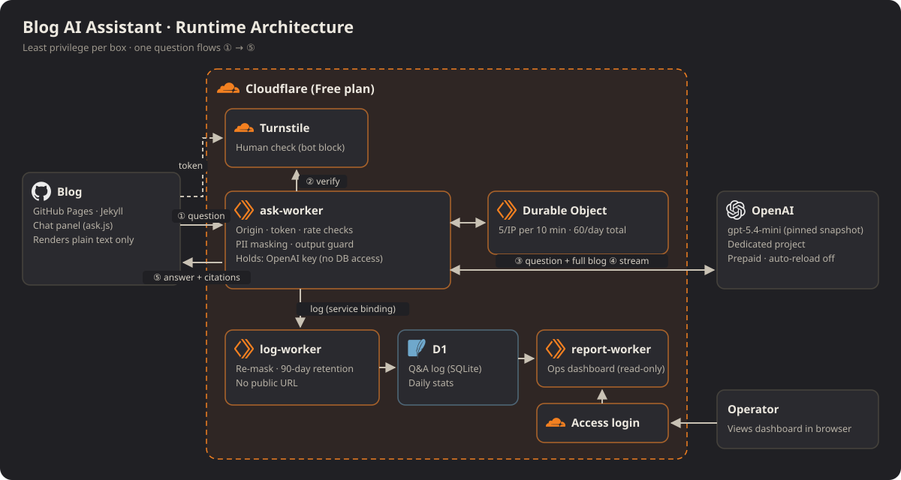



> **요약** 이 블로그 글만 근거로 답하는 AI 비서를 만들었다. 서버는 Cloudflare 무료 플랜, 모델은 OpenAI. 월 비용 상한은 5달러다.
{: .prompt-tip }

## 만든 것

_답이 생성되는 대로 보이고, 끝나면 근거가 된 단락 링크가 붙는다_

_운영 대시보드: 질문 수, 응답 시간, 비용, 답하지 못한 질문_

## 왜 만들었나

글이 쌓이면서 "이 블로그에 대해 물어보면 해당 글로 데려다주는 기능"이 필요해졌다. 방법은 셋이었다.

| 방법 | 걸림돌 |
|---|---|
| 기존 AI 팝업(브라우저 Gemini 등) | 블로그에 넣는 위젯이 아니고, 내 글만 근거로 답하게 제어할 수 없다 |
| 모델 직접 서빙 | 공개 블로그를 24시간 받칠 서버·GPU 비용 |
| **API + 중간 서버** ✅ | 공개 입력창을 직접 지켜야 한다 |

GitHub Pages에는 서버가 없다. 브라우저에서 API를 바로 부르면 키가 페이지 소스에 드러난다. 그래서 키를 숨기는 **중간 서버(게이트웨이)** 를 두었다.

그리고 MLOps 시리즈의 흐름(서빙 → 감시 → 판단 → 교체)을 LLM에 그대로 옮겨 보기로 했다. 이 시리즈가 그 기록이다.

## 구조

{: .light }
{: .dark }

| 구성 | 역할 | 가진 권한 |
|---|---|---|
| 질문 창 | 질문 보내기, 답 표시 | 없음 |
| ask-worker | 확인 → 가림 → OpenAI → 출력 가드 | OpenAI 키만 |
| log-worker | 기록 저장, 90일 삭제 | D1 쓰기 (공개 주소 없음) |
| report-worker | 운영 대시보드 | D1 읽기 (로그인 필요) |

## 시리즈 지도

| 편 | 주제 | 핵심 한 줄 |
|---|---|---|
| 1 | 보안 원칙 | 코드보다 원칙을 먼저 썼다 |
| 2 | 공급망 | 공개 2주가 지난 버전만 쓴다 |
| 3 | 어댑터와 코퍼스 | 블로그 전문을 매번 넣고, 링크는 코드가 만든다 |
| 4 | 가드레일 | 한국어에서 개인정보 가림이 샜다 |
| 5 | 평가 | 점수는 실행마다 9%p 흔들린다 |
| 6 | 게이트웨이 배포 | Worker를 권한별로 셋으로 나눴다 |
| 7 | 운영과 비용 | 하루 상한을 숫자로 계산했어야 했다 |
| 8 | 회귀 감시와 회고 | 검사 도구도 검사해야 한다 |
| 부록 | 용어집 | |
