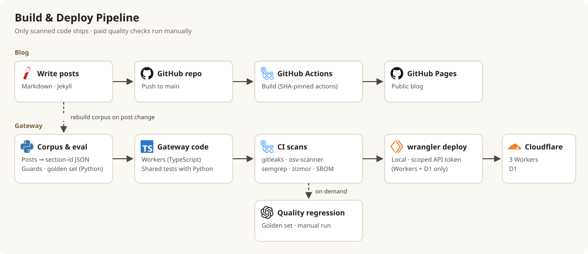
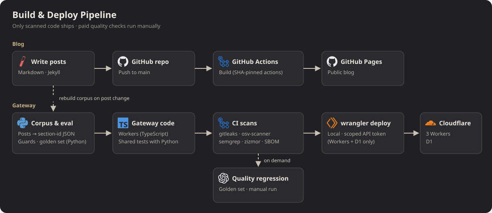



> **요약** 악성 패키지는 보통 공개 며칠 안에 발견돼 내려간다. 그래서 새 버전을 바로 쓰지 않고 2주를 기다린다. 대신 보안 패치도 2주 늦게 받는다는 걸 감수한다.
{: .prompt-tip }

## 한 일

{: .light }
{: .dark }

| 장치 | 무엇을 막나 | 설정 |
|---|---|---|
| lockfile + 해시 | 같은 버전 이름에 다른 파일이 깔리는 것 | `uv.lock`, `package-lock.json`, `Gemfile.lock` |
| 2주 대기 | 막 올라온 악성 버전 | uv `exclude-newer`, npm `before`, Dependabot `cooldown: 14` |
| 빌드 스크립트 금지 | 설치 = 남의 코드 실행 | uv `no-build`, npm `ignore-scripts` |
| 스캐너 | 알려진 취약점, 키 유출, 위험한 코드·워크플로 | osv-scanner, gitleaks, semgrep, zizmor |
| SBOM | "이 취약점 우리도 해당되나?"에 바로 답하기 | CycloneDX, 네이티브 코드 패키지 따로 표시 |
| 액션 SHA 고정 | 태그를 바꿔치기한 GitHub Action | `uses: actions/checkout@<커밋 해시>` |

```toml
# pyproject.toml (일부)
[tool.uv]
exclude-newer = "2026-10-25T00:00:00Z"   # 이 날짜 이후 공개된 버전은 고르지 않는다
no-build = true                          # 소스 배포본(설치 시 코드 실행) 금지
```

날짜는 "오늘-14일"이 아니라 **고정 날짜**로 쓴다. 상대 날짜면 같은 lockfile을 다시 만들 때마다 결과가 바뀐다.

## 문제

1. 배포 도구 wrangler가 끌고 오는 `undici`에 **High 8건**.
2. 정적 분석 도구 semgrep **자신의 의존성**(`mcp`)에 High.
3. 블로그 빌드용 Ruby 이미지는 2주 규칙을 지킬 수 있는 버전이 없었다.

## 해결

| 문제 | 해결 |
|---|---|
| undici | npm `overrides`로 수정 버전(7.30.1) 강제 → 0건 |
| semgrep의 mcp | uv `override-dependencies`로 수정 버전 강제. 남은 Medium 1건은 **사유와 만료일**을 적은 예외로 |
| Ruby 이미지 | 예외로 문서화(이유: 대체 불가, lockfile 생성에만 사용) |

예외는 만들어도 된다. 다만 **사유와 만료일이 없는 예외**는 만들지 않는다.

## 정리

- 공급망 방어는 "고정 → 대기 → 검사 → 목록화" 네 겹이다.
- 스캐너도 공급망의 일부다. 검사 도구의 의존성도 검사한다.
