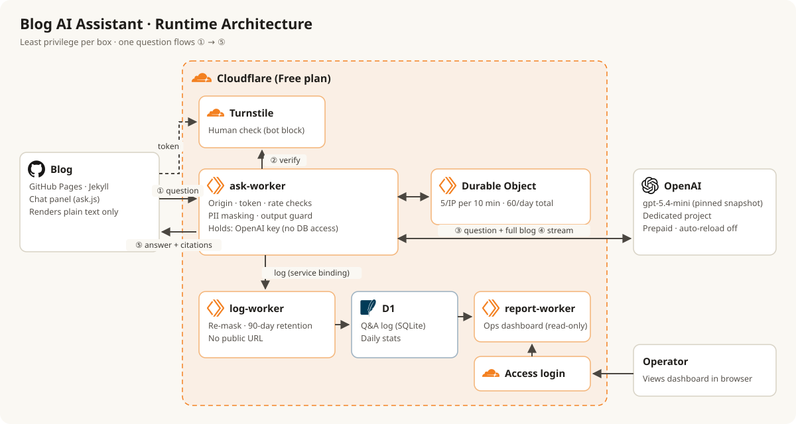
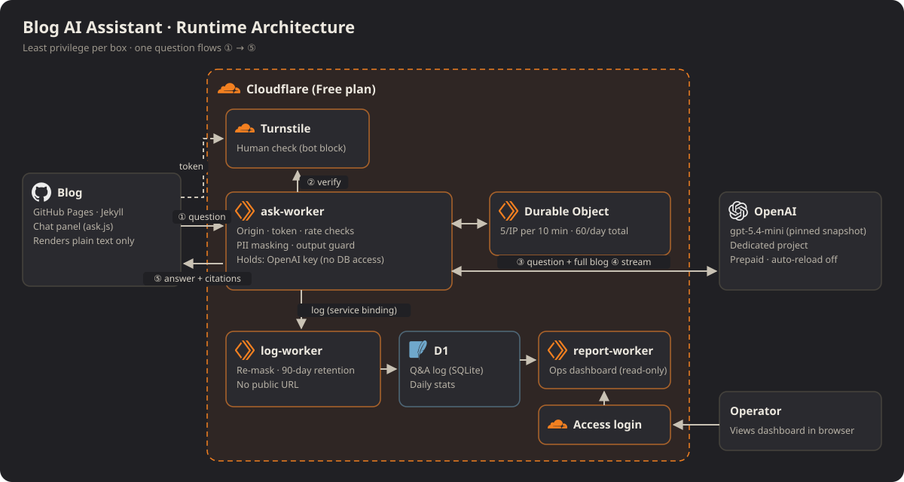
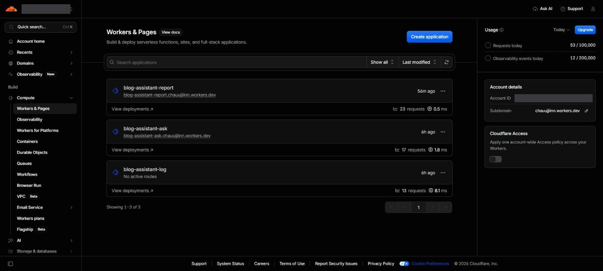
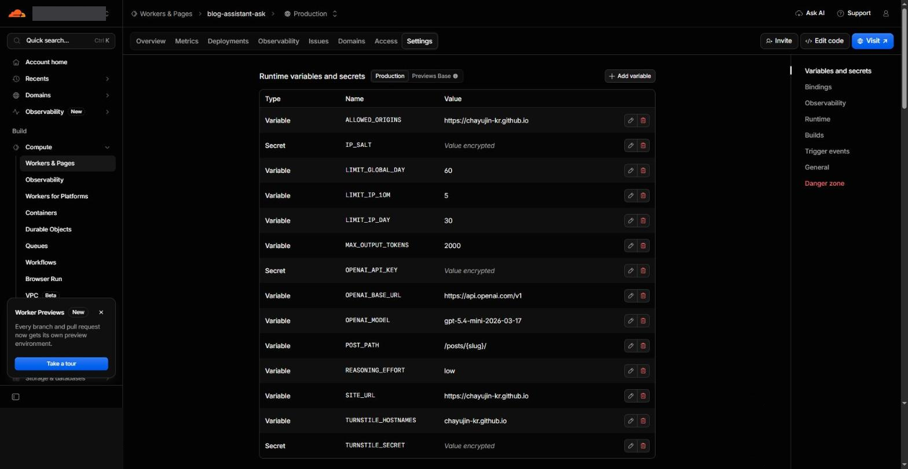
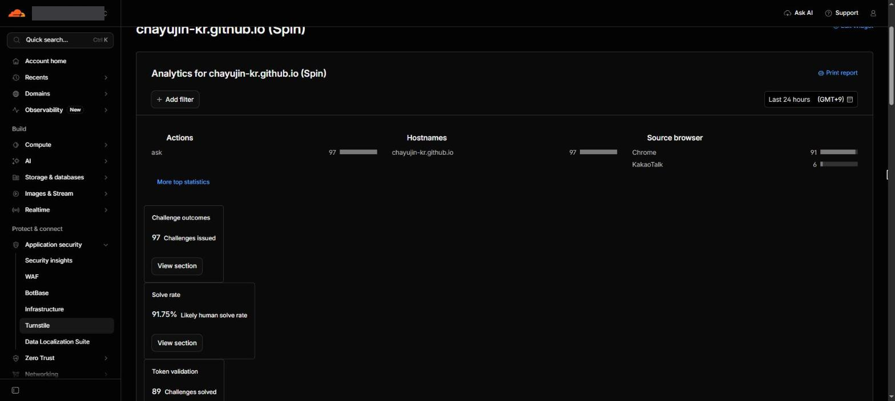
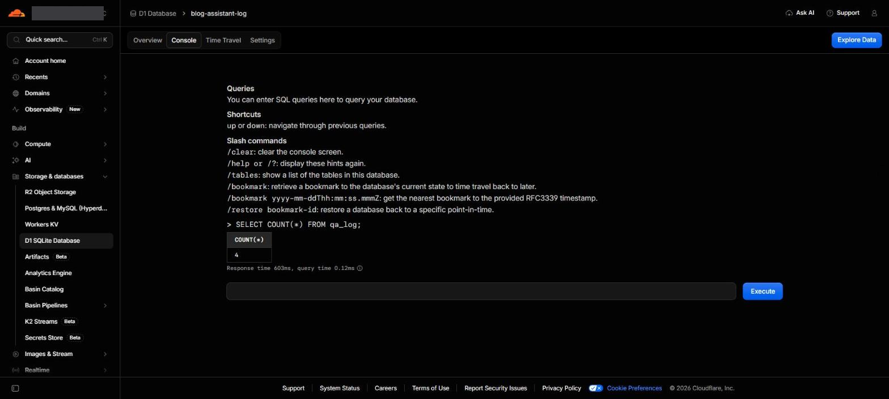
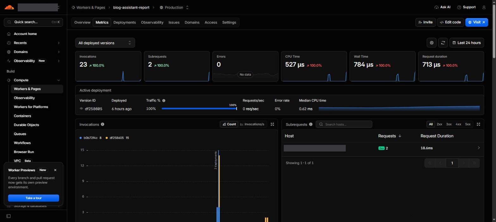



> **요약** 질문을 받는 Worker에는 DB 권한을 주지 않았다. 기록은 공개 주소가 없는 별도 Worker가 한다.
{: .prompt-tip }

## 구성

{: .light }
{: .dark }



| Worker | 가진 것 | 공개 주소 |
|---|---|---|
| ask | OpenAI 키 | 있음 |
| log | D1 쓰기 | 없음 (ask가 내부로만 부름) |
| report | D1 읽기 | 있음, 로그인 필요 (7편) |

질문 한 번의 확인 순서:

1. 출처가 내 블로그인가
2. Turnstile 토큰이 유효한가 (사람 확인, 보통 클릭 없이 통과)
3. 횟수 제한: IP별 10분 5회·하루 30회, 전체 하루 60회
4. 개인정보 가림 → OpenAI → 출력 가드 → 스트리밍

IP는 원문을 저장하지 않고 비밀 값을 섞은 해시로만 센다.

## 설정 화면


_비밀 값은 Settings → Variables and Secrets에만. 코드와 저장소에는 없다_


_Turnstile 분석: 하루 동안 사람 확인 97회, 전부 블로그 호스트에서. 사람으로 보이는 통과율 91.75%_


_D1(SQLite) 콘솔에서 기록 확인_

```toml
# wrangler.ask.toml (일부)
ALLOWED_ORIGINS = "https://chayujin-kr.github.io"
OPENAI_MODEL = "gpt-5.4-mini-2026-03-17"
LIMIT_GLOBAL_DAY = "60"

[[services]]            # 기록은 log Worker로 (인터넷을 거치지 않음)
binding = "LOG"
service = "blog-assistant-log"
```

Cloudflare 기본 요청 제한은 10초·60초 구간만 지원해서, "하루 30회"는 **Durable Object**(Worker용 작은 저장소)로 직접 셌다.


_Worker마다 기본 지표(요청 수, 오류, CPU 시간)가 따로 쌓인다_

## 문제

1. Cron(정기 실행)이 있는 log Worker가 배포되지 않았다.
2. `workers.dev` 서브도메인을 바꾸려다 Worker 이름을 바꿔 버렸다.
3. 터미널에서 넣은 시크릿이 빈 값이었다.
4. 실제 블로그에 질문 버튼이 하나도 안 나타났다. 로컬 미리보기에서는 됐다.

## 해결

| 문제 | 원인 | 해결 |
|---|---|---|
| Cron 배포 실패 | 계정 이메일 미인증 | 인증 후 재배포 |
| 이름 혼동 | 주소는 `Worker이름.서브도메인.workers.dev`. 서브도메인은 계정에 하나, 이름은 Worker마다 | 원래 이름으로 되돌림 |
| 빈 시크릿 | 붙여 넣기로 실행해 입력 창 없이 빈 값이 들어감 | 대시보드에서 직접 입력 |
| 버튼 없음 | 스크립트가 상단 바보다 먼저 실행돼 붙을 곳이 없었음. 미리보기는 상단 바가 처음부터 있어서 몰랐다 | 페이지 준비 후 시작, 미리보기도 실제와 같은 순서로 |

## 정리

- 권한을 나누면 한 곳이 뚫려도 피해가 그 상자 안에 머문다.
- 설정 문제는 오류 원문부터 본다: **Worker → Logs → Real-time Logs** 또는 `wrangler tail`.
- 미리보기는 실제 환경과 같은 순서로 만들어야 의미가 있다.
