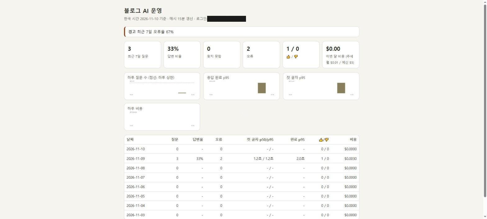
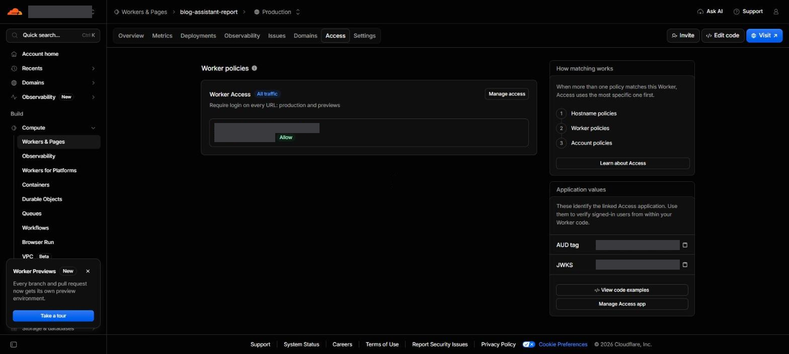
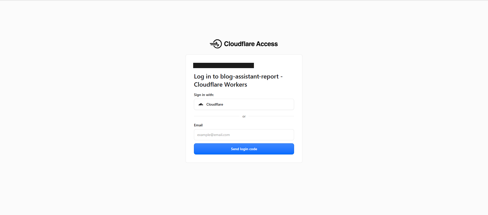
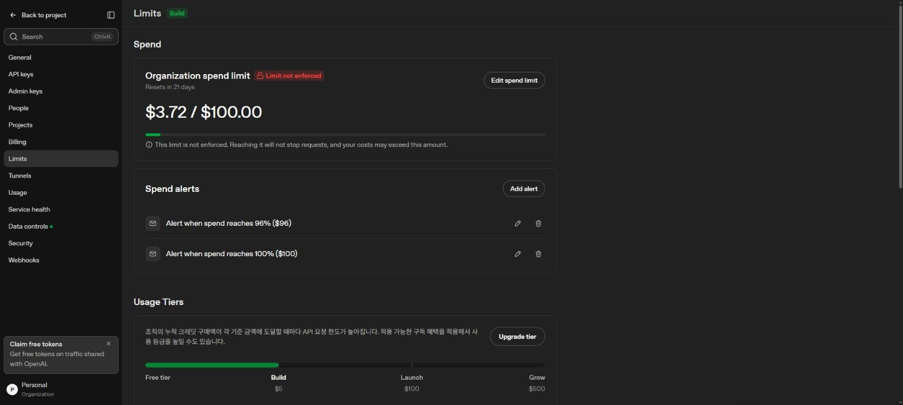
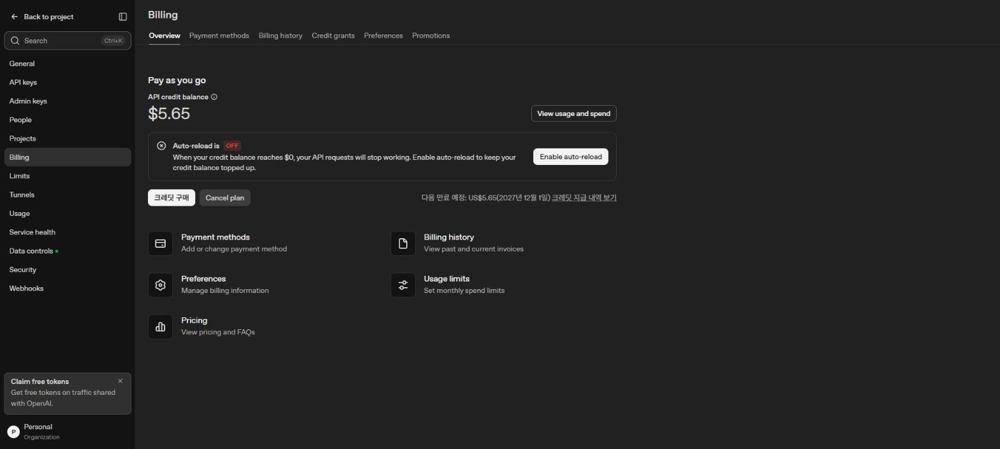



> **요약** 공개 LLM 기능의 비용은 단가가 아니라 "누가 몇 번 부를 수 있나"로 정해진다. 그리고 평가 비용도 예산이다.
{: .prompt-tip }

## 운영 대시보드


_"최근 7일 오류율 67%" 경고: 크레딧이 바닥난 날의 오류가 그대로 잡혔다_

| 보는 것 | 왜 |
|---|---|
| 일별 질문 수, 제한에 걸린 수 | 남용 감지 |
| 답함 / 찾지 못함 / 오류 | 품질·장애 |
| 첫 글자까지·완료까지 시간 | 체감 속도 |
| 토큰, 비용, 월 추정 | 예산 |
| 답하지 못한 질문 | **다음 글 주제** |

대시보드는 매시간 미리 집계한 표만 읽는다. LLM은 쓰지 않는다(1편: 로그를 LLM에 넣지 않기로 함).

## 잠그기: Cloudflare Access


_내 이메일만 허용_


_대시보드 주소로 가면 로그인부터. Cloudflare 계정 또는 이메일로 받은 일회용 코드_

Access만 믿지 않고 Worker 코드에서도 Access 토큰의 서명·대상·만료를 확인한다. 설정 실수로 Access가 꺼져도 열리지 않는다. 실제로 처음엔 다른 줄에서 Access를 켜서 주소가 그냥 열렸었다.

## OpenAI 설정


_조직 지출 한도에 "Limit not enforced": 넘어도 요청이 멈추지 않는다. 알림일 뿐이다_


_선불 크레딧, 자동 충전(Auto-reload) 꺼짐. 잔액이 0이 되면 요청이 멈춘다_

그래서 실제 상한은 OpenAI 한도 화면이 아니라 **선불 잔액**과 **Worker의 하루 상한**이다.

## 문제

1. **하루 상한 300건.** 운영 리포트를 만들며 단가를 계산해 보니, 300건을 매일 다 쓰면 **월 약 $24**였다. 예산은 $5다.
2. **크레딧이 바닥나 질문 창이 멈췄다.** 품질 검사(8편)를 하루에 여러 번 돌렸고, 평가와 서비스가 같은 키를 쓰고 있었다. 블로그 질문 창이 `429 billing_not_active`로 멈췄다.

## 해결

| 문제 | 해결 |
|---|---|
| 상한 | 질문당 약 $0.003 × 60건 × 30일 ≈ **월 $5** → 하루 60건 |
| 크레딧 소진 | 자동 충전을 꺼 둔 덕에 돈은 더 안 나갔다. 품질 검사는 수동으로만, 평가용 키는 분리 예정 |

```text
월 최대 비용 = 질문당 비용 × 하루 상한 × 30
```

상한을 정할 때 이 한 줄을 먼저 계산했어야 했다.

## 정리

- 하루 상한 + 선불 + 자동 충전 끔: 최악의 경우가 "멈춤"이지 "청구서"가 아니게 만든다.
- 실험과 서비스는 키·예산을 나눈다.
